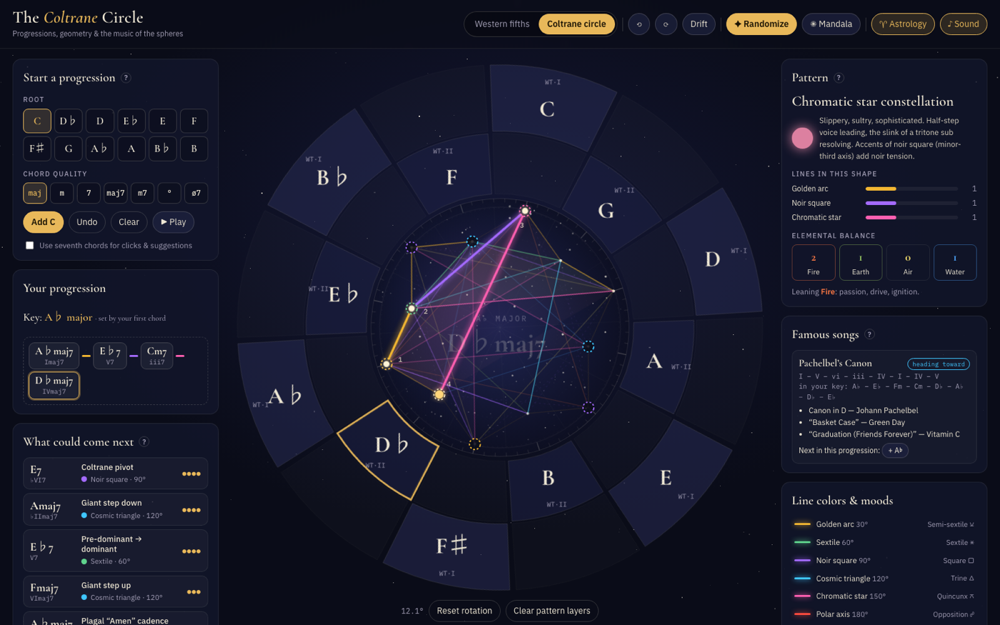

# The Coltrane Circle

An interactive set of music wheels: the circle of fifths, Coltrane's circle, the chromatic circle and the diatonic circle. Build chord progressions, watch them draw geometric patterns across the wheel, and explore the songs, moods and lore behind them.



## Features

- **Four circles, each with its own logic.** Every wheel has its own layout, line colors, tooltips, figures, suggestion bias and lore:
  - **Fifths:** the classic circle of fifths with relative minors.
  - **Coltrane:** Coltrane's two whole-tone rings with major-third triangles.
  - **Chromatic:** the twelve notes as a clock, with parallel minors inside. Half steps are the shortest lines, the cycle of fifths becomes a {12/5} star, and your current chord is drawn as a polygon in the hub.
  - **Diatonic:** the seven chords of your key as a heptagon in fifths order, with a tonic / pre-dominant / dominant ring. Steps, fifths and thirds draw the {7/2}, {7} and {7/3} figures, and chords from outside the key sit off the ring with dashed lines.
- **Progression builder.** Start a progression on the left (or click the wheel). Next-chord suggestions explain *why* each move works: functional harmony, borrowed chords, secondary dominants, tritone substitutions and Coltrane changes.
- **Geometry.** Each chord change draws a colored line across a starry astrolabe. The color comes from the jump distance (fifth, sextile, square, trine, quincunx, opposition), and each color has its own mood.
- **Famous songs.** Your chords are matched against well-known progressions in any key, with the next chord one click away.
- **Astrology reading.** On the twelve-fold wheels: zodiac signs (Aries = C), element trines (augmented triads), modality squares (diminished 7ths), aspects and figures like the Grand Trine or Yod. On the diatonic wheel: the seven classical planets, which spell the weekdays around the circle of fifths.
- **Randomize & Mandala.** Generate progressions and layer them into geometric figures. Rotate or drift the wheel.
- **Sound.** Web Audio playback of each chord and the whole progression.

## Controls

| Action | Mouse | Keyboard |
| --- | --- | --- |
| Add a chord | Click a wheel slice or a suggestion | — |
| Remove a chord | Click its chip | Backspace (last chord) |
| Play progression | ▶ Play | Space |
| Randomize | ✦ Randomize | R |
| Rotate the wheel | ⟲ / ⟳ | ← / → |

## Running locally

There's no build step. Open `index.html` in a browser, or serve the folder:

```sh
python3 -m http.server 8000   # then visit http://localhost:8000
```

## Hosting on GitHub Pages

1. Push this repository to GitHub.
2. Go to **Settings → Pages**, set *Source* to "Deploy from a branch", then pick `main` and `/ (root)`.
3. The site will be live at `https://<username>.github.io/<repo>/`.

For link previews (Slack, iMessage, etc.), change the `og:image` meta tag in `index.html` to the full URL, e.g. `https://<username>.github.io/<repo>/assets/social-preview.png`. Some sites ignore relative image paths.

## Project structure

```
index.html                 the whole app (HTML, CSS, JS)
assets/favicon.svg         tab icon
assets/screenshot.png      README image
assets/social-preview.png  link-preview image (1200×628)
.nojekyll                  serve files as-is on GitHub Pages
```

## A note on the lore

The astrological correspondences are a symbolic tradition, not science, and other systems map the signs differently. The chromatic wheel runs the signs by semitone instead of by fifth, and the planetary reading on the diatonic wheel is likewise symbolic. The two-ring view of Coltrane's circle is one common reading of the drawing he gave Yusef Lateef; musicians interpret it in several ways.

## License

[MIT](LICENSE)
